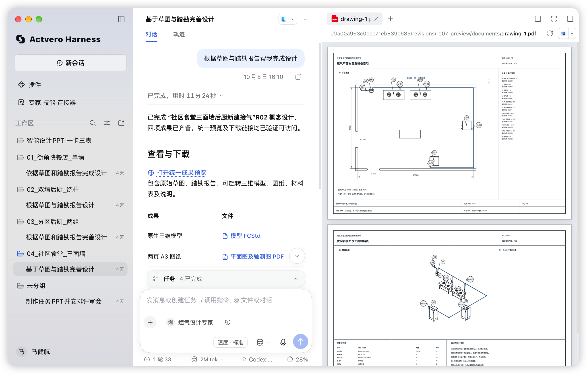
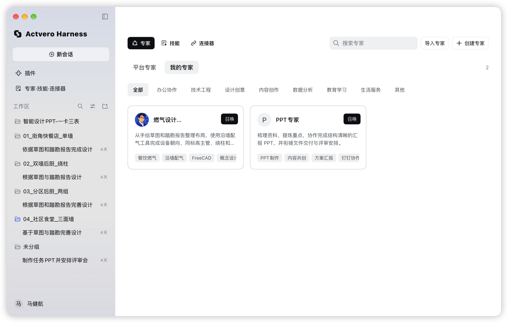
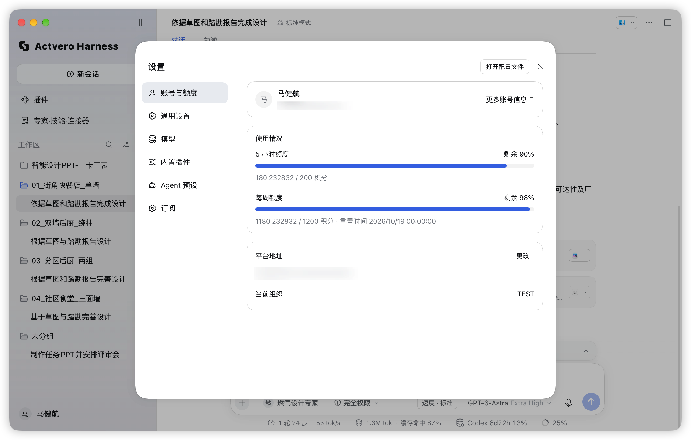

# Actvero Harness

English | [中文](README.md)

**The desktop Agent for Actvero's enterprise AI solution.**

[Features](#features) · [Actvero platform](#actvero-platform) · [Getting started](#getting-started) · [Development](#development) · [MIT License](LICENSE)

Actvero Harness (`actvero-harness`) is a desktop Agent built on [DeepSeek Harness (DSH)](https://github.com/deepseek-ai/deepseek-harness). It connects the Actvero platform's models, experts, Skills and MCP tools to local workspaces, helping people work with files, execute tasks and inspect the results.

Work with an expert, follow the task and inspect the delivered files in one workspace.

## Features

Bring the capabilities your organization provides into the place where you do the work.

| Capability | What you can do |
| --- | --- |
| Workspaces and conversations | Organize tasks around working directories, conversation history and relevant files. |
| Experts | Choose platform or personal experts that combine task instructions with the Skills and tools they need. |
| Skills and MCP connectors | Reuse working methods and connect the conversation to authorized local tools and business systems. |
| Task execution | Let the Agent work through model requests and tool calls, with progress and results visible in the conversation. |
| Files and previews | Inspect generated documents, drawings and other deliverables alongside the conversation. |
| Platform accounts and models | Sign in to your organization, select an authorized model and view the quota reported by the platform. |
| Local configuration | Use configured model providers, local Skills and custom MCP connections. |

### Experts, Skills and connectors

Browse experts by category and choose the capabilities needed for a task. An expert combines instructions and dependencies; its available tools depend on the installed Skills, configured connectors and your access permissions.

The examples show configured experts. Their specialized capabilities require the corresponding expert packages and tools.

### Account and quota

View your account, current organization, platform connection and remaining quota from the desktop. Quota periods and limits come from the connected platform.

## Part of the Actvero solution

The Actvero platform manages, authorizes and distributes enterprise AI capabilities. Actvero Harness uses those capabilities to carry out tasks on the desktop.

| | Actvero platform | Actvero Harness |
| --- | --- | --- |
| Runs on | Your server | The user's computer |
| Manages | Organizations, members, models, experts, Skills, MCP resources and quotas | Workspaces, conversations, task context, tool execution and output files |
| Provides | Authorized capabilities and records of platform usage | Work results that users can inspect and use |

Platform resources require a reachable Actvero service and the appropriate account permissions. Local mode also supports separately configured capabilities; only requests that pass through the platform are covered by its corresponding access controls and metering.

## Getting started

For an organization deployment, obtain the desktop application and platform address from your Actvero administrator. For source development or your own distribution, use the [desktop development guide](actvero/README.md) and [build and packaging guide](actvero/building/README.md).

1. Connect to your Actvero platform and sign in with your account.
2. Confirm the organization when prompted, then choose an available model or expert.
3. Select a workspace, describe the task and provide the relevant files.
4. Follow the execution, respond to requests for information or approval, and inspect the results.

You can also enter local mode and configure your own model and tools. Organization resources and platform quota information require a platform connection.

The underlying DSH runtime is in developer preview, and compatibility can change. Read the [safety notice](SAFETY.md) before running agents with access to files, commands or external services.

## Development

This repository contains the desktop application, its DSH runtime and Actvero integrations. The Actvero platform is maintained separately.

| Guide | Purpose |
| --- | --- |
| [Desktop development](actvero/README.md) | Prepare the development environment and start the Actvero account flow. |
| [Build and packaging](actvero/building/README.md) | Configure application branding and produce a desktop package. |
| [Windows installer](actvero/building/windows.md) | Prepare the Windows toolchain, package and test an EXE. |
| [Expert packages](actvero/expert-package.md) | Package an expert with its Skills and connector dependencies. |
| [Capability integration](actvero/capabilities.md) | Understand desktop integration with experts, Skills and MCP. |
| [Development guide](docs/development.md) | Set up the repository and follow its build and testing workflow. |
| [Architecture](docs/architecture.md) | Understand DSH's plugin architecture and extension points. |

### DSH Web and plugin development

The repository also retains DSH's Web and plugin development paths. Follow the setup and application commands in the [development guide](docs/development.md); Actvero's native account and capability integrations use the desktop development entry linked above.

For work performed by coding agents, follow [AGENTS.md](AGENTS.md).

## Built on DeepSeek Harness

Actvero Harness is a downstream project based on [DeepSeek Harness](https://github.com/deepseek-ai/deepseek-harness), developed by [DeepSeek AI](https://deepseek.com). DSH provides the Agent runtime and its plugin architecture, powered by [Cordis](https://github.com/cordiverse/cordis).

Actvero adds integration with its enterprise platform, including desktop identity and organization access, the model gateway, experts, Skills and MCP resources. The upstream copyright, license and third-party notices are retained. The pinned runtime baseline is recorded in [upstream.lock.json](actvero/upstream.lock.json).

Thanks to the DeepSeek Harness, Cordis and wider open-source communities whose work makes this project possible.

## License

This project is licensed under the [MIT License](LICENSE). Third-party components retain their respective licenses; see [THIRD_PARTY_NOTICES.md](THIRD_PARTY_NOTICES.md).
