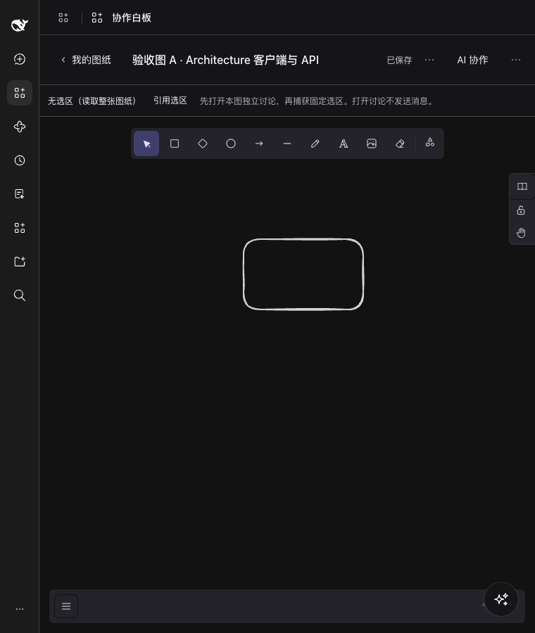
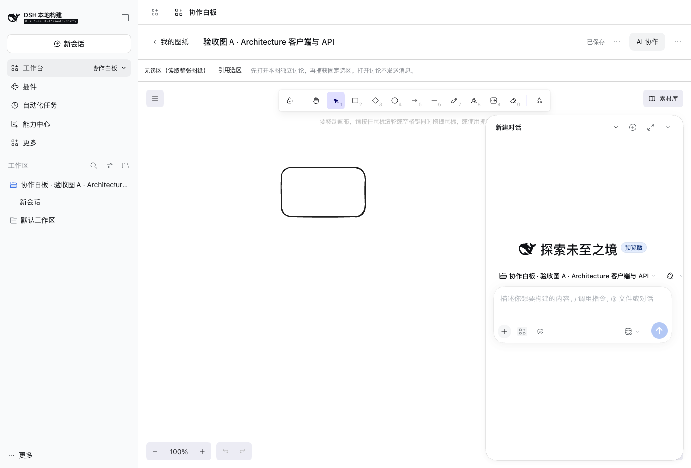

# Collaborative whiteboard independent development trial

English | [中文](evaluation.zh.md)

## Readers and conclusion

This document is for maintainers of the workbench framework, developer tools, and the two development Skills. It records the independent trial and review on 2026-11-08. The [requirements handbook](requirements.md) owns the business goals and acceptance criteria.

The current guidance helps an Agent with no history from this conversation create a project, integrate real Excalidraw, implement local data operations, and install into an isolated Profile. It does not yet ensure that standard commands alone can deliver a complex workbench: the project needed additional dependency bundling and Host syntax handling, and this trial did not implement some native AI interactions.

The trial artifact is a runnable prototype, not a fully accepted release. Eight passing storage tests and controlled tool calls do not establish complete import/export, AI collaboration, or every recovery path. Independent review also found two business implementation defects.

## Trial method

The developer was the independent subagent `whiteboard_development_trial`, started without the parent conversation. Its inputs were the confirmed handbook, reference image, paths to the two Skills, and source toolchain location. It received no expected implementation, suspected defect, or proposed repair. The Skills were “Workbench development” and “Workbench frontend guidelines”.

The DSH baseline was `0.2.1-rc.3`. Input hashes for the requirements, image, Skills, and guide are in `.artifacts/workbench-trials/evaluation-input.json`; verification found no changes during the trial. All implementation output is under `.artifacts/workbench-trials/collaborative-whiteboard/`. The trial did not change Host source, root dependency declarations, or development guidance, and was not integrated into the daily client.

The subagent could inspect real source and official documentation, install dependencies in the independent project, adjust its build, and use a dedicated local Profile. It made no paid model calls and published no workbench. The parent Agent separately reviewed data operations after implementation; that review is not part of the subagent’s eight tests.

## Observed results

The table records the actual scope of evidence. The trial project’s `ACCEPTANCE.md` contains the individual cases. Screenshots, logs, and failure reproductions are under its `evidence/` directory; a visible button does not establish its behavior.

| Scope | Actual evidence | Limits |
|---|---|---|
| Initialization and package checks | Project generation, doctor, type checking, build, and archive checks were executed | Project-owned precompilation scripts were added; this does not establish direct toolchain support for every dependency |
| A1–A3 Drawing management and saving | Real native canvas, manual drawing, saving, return to list, and reopening; storage tests cover independent drawings, copying, and restoration | Images, complete viewport restoration, and all menu paths lack complete real-UI acceptance |
| A4 Import/export | Storage tests cover valid and invalid imports without damaging existing files | Real file import, PNG export, and image-containing round trips still require complete verification |
| A5–A7 AI data editing | Storage tests cover fixed selections, alignment and connections, revision conflicts, and no invalid batch writes; the real tool runtime reads, moves a node, and undoes the edit | No real model execution evidence; undo and clear checks have the defects listed below |
| A8 Native AI and drawing association | Real native AI popup and fixed reference identifier; bundled expert activation succeeds, and business tool calls from an ordinary session return `UNKNOWN_TOOL` | Automatic selection attachment at native send time is absent; real model collaboration remains unverified |
| A9 Failure recovery | Tests cover corrupt data, read failure, and writes into a read-only directory, followed by retry after restoring permissions | UI retention and retry after write failures remain unverified |
| A10 Layout adaptation | Narrow-window and light/dark screenshots are retained | All long-text, keyboard, and display-state combinations remain unverified; font requests fail |
| A11 Installation and loading | Package installed into isolated `whiteboard-trial` Profile; switcher entry and real business canvas observed | This establishes only the test Profile state, not installation into the daily ACTVERO client |

## Actual interface and artifacts

These are real client screenshots of `1.0.4`: the native canvas retains content when reopened, and the native AI popup opens. They are not mockups and do not establish that every acceptance case passes.

The local package is `@local/collaborative-whiteboard@1.0.4`, at `dist/local-collaborative-whiteboard-1.0.4.tgz` inside the trial project, with a size of 2,844,099 bytes. [evidence.json](evidence.json) records input hashes, package SHA-256, check exit codes, and independent review results. Full editable source remains in the trial directory and is not integrated as a Host feature.

## Guidance and toolchain findings

These findings come from executed commands, runtime errors, and source inspection. Workbench implementation errors are recorded separately from missing Host capabilities.

| Category | Finding | Effect on standard development |
|---|---|---|
| Third-party component build | Excalidraw CSS conditional export resolution failed; direct bundling also raised `dynamic chunk ... client.pica.js ... has no generated import expression` | Complex dependencies need an explicit reusable resource and chunking procedure beyond simple templates |
| Host build validation | Initial output retained `@Remote` decorators; archive checks passed while Node syntax checking and real loading failed | Archive validation and executable-entry checks must remain distinct; decorator compilation needs an explicit supported scope |
| Remote example | A mounted business Remote also needs injection in the correct child scope; the first business view failed here | An executable complete Host/Client Remote example should cover mounting, injection, and lifetime |
| Native AI interaction | The public workbench interfaces inspected during this trial supplied no automatic drawing-selection attachment at send time | The prototype explicitly uses manually copied fixed reference IDs; this does not satisfy the requested automatic reference |
| Project implementation | Selection state updates caused a React update loop; a missing discussion directory caused `realpath` failure; the subagent repaired both in later versions | These are implementation and UI-validation errors, not all attributable to a Skill or framework |
| Resource completeness | Browser evidence records local 404 responses for Assistant fonts | The result cannot claim complete fonts or offline resources; resource packaging and offline acceptance need completion |
| Preview completeness | AI edits or undo clear the thumbnail without automatically regenerating it | Agent editing needs management-card and result-preview acceptance beyond manual-save checks |
| Launch isolation | `pnpm dsh web --help` attempted default Profile preparation rather than only printing help; the sandbox rejected writing | Test launches need explicit isolated directories; help arguments are not confirmed read-only probes |

CSS, dynamic-chunk, and initial Host syntax failures have separate reproductions. Installation, build, and browser evidence distinguish workbench versions. Where retries overwrote earlier combined logs, labeled reproductions or error excerpts replace those parts rather than posing as complete original logs.

## Independent review findings

The parent Agent exercised the real `BoardStore` in a temporary directory using `.artifacts/workbench-trials/parent-review.mts`, with results in the adjacent `parent-review.json`. The review used separate data and did not change the subagent’s business source.

| Operation | Observation | Effect |
|---|---|---|
| Edit element A and undo the complete operation | Element order changes from `[A, B, C]` to `[B, C, A]` | Element order controls stacking in Excalidraw; undo does not restore the complete original scene |
| Batch-update every element to `isDeleted: true` | Operation accepted; visible element count becomes zero without clear confirmation | Checking only the deletion list does not enforce the clear-confirmation requirement |

These defects remain unresolved. The prototype must not be delivered as a release that has completed A5–A7. Existing passing tests retain their limited coverage and do not imply that these defects are absent.

## Follow-up order

First improve executable validation of third-party dependencies and Host entries, then document the actually exercised Remote integration as a guide and example. The Skill should route decisions and acceptance, not duplicate an entire compiler manual.

Next complete native conversation business references, with explicit ownership of drawing identity, selection at send time, and tool scope. Missing Host capabilities require framework implementation; adding a sentence to a Skill cannot supply them.

At the business layer, repair undo and clear checks and add regression coverage. Complete import/export, offline resources, expert activation, and recovery acceptance. Then run another fresh independent Agent trial and judge guidance against new evidence, rather than declaring success after wording changes alone.
