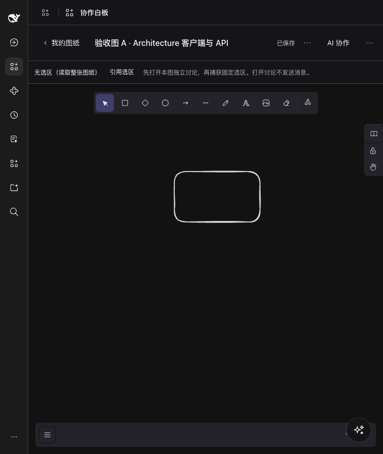
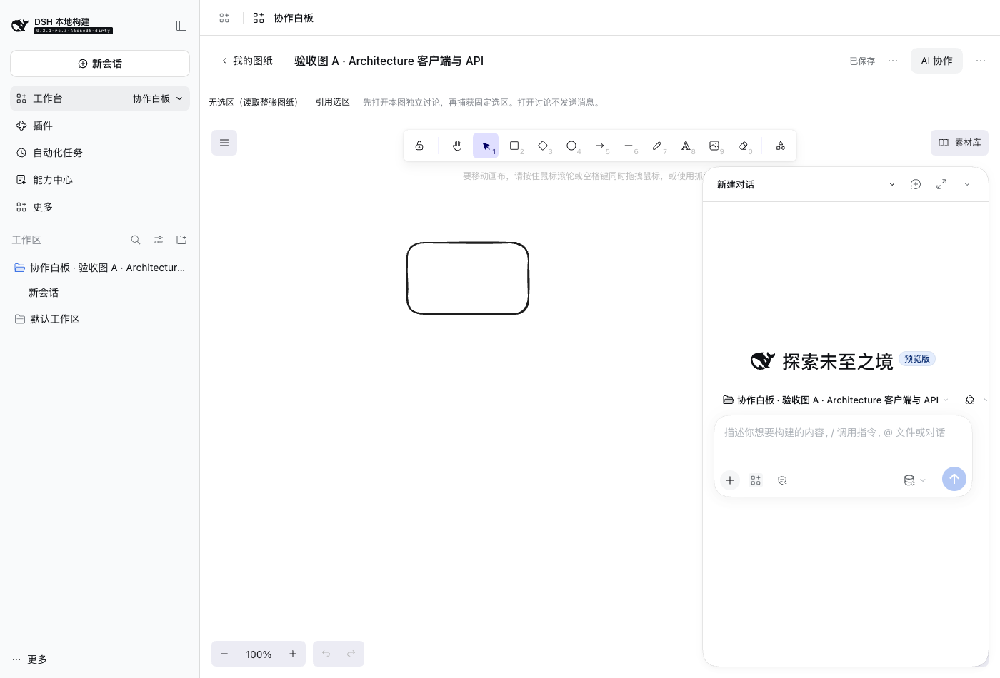

# 协作白板独立开发试跑

[English](evaluation.md) | 中文

## 阅读对象与结论

本文供维护工作台框架、开发工具及两份开发 Skill 的人员使用，记录 2026-11-08 的独立试跑与复核结果。业务目标和验收条件以[需求手册](requirements.zh.md)为准。

现有规范能帮助一个没有本次对话历史的 Agent 创建项目、接入真实 Excalidraw、实现本地数据逻辑并安装到隔离 Profile。它仍不足以保证开发者只沿着标准命令就能交付复杂工作台：第三方组件打包和 Host 语法处理需要项目自行补充，部分原生 AI 交互也没有在本次试跑中实现。

试跑交付物是可运行原型，不能标记为全部验收通过。8 组存储测试和受控工具调用通过不等于导入导出、完整 AI 协作和所有故障恢复均已通过；独立复核还发现了两个业务实现缺陷。

## 试跑方式

开发者为独立 subagent `whiteboard_development_trial`，启动时不继承父对话。输入只有确认后的需求手册、效果图、两份 Skill 的位置和源码工具链位置；没有提供预期实现、已知问题或建议修复。两份 Skill 分别是「工作台开发」和「工作台前端规范」。

DSH 基线为 `0.2.1-rc.3`。需求、图片、Skill 和指南的输入哈希保存在 `.artifacts/workbench-trials/evaluation-input.json`，试跑期间复核均未改变。开发输出全部位于 `.artifacts/workbench-trials/collaborative-whiteboard/`；未修改宿主源码、根依赖声明或开发规范，也未合入日常客户端。

subagent 可以查阅真实源码和官方资料，在独立项目内安装依赖、调整构建及使用专用本地 Profile。没有调用付费模型，没有发布工作台。父 Agent 在实现后另做数据操作复核；该复核结果不计入 subagent 的 8 组测试。

## 已观察到的结果

下表按证据的实际范围记录，完整逐项记录位于试跑项目的 `ACCEPTANCE.md`。截图、日志与失败复现位于项目的 `evidence/`，不能以某个按钮出现在截图中代替其行为验收。

| 范围 | 实际证据 | 限制 |
|---|---|---|
| 项目初始化与包检查 | 项目已生成，doctor、类型检查、构建和归档检查已执行 | 构建过程中增加了项目自有预编译脚本，不能据此声称标准工具链直接支持所有依赖 |
| A1–A3 图纸管理与保存 | 实际打开原生画布、手绘、保存、返回列表及重开；存储测试覆盖独立图纸、复制和恢复 | 图片、完整视角恢复和所有菜单路径没有全部完成真实界面验收 |
| A4 导入导出 | 存储测试覆盖有效与错误导入不破坏已有文件 | 真实文件导入、PNG 导出及含图片往返仍待完整验证 |
| A5–A7 AI 数据修改 | 存储测试覆盖固定选区、对齐连线、版本冲突与无效批量不写入；真实工具运行器完成读取、移动节点和撤销 | 没有真实模型执行证据；撤销和清空检查存在下文列出的缺陷 |
| A8 原生 AI 与图纸关联 | 实际打开原生 AI 浮窗并生成固定引用编号；随包专家成功激活，普通会话调用业务工具返回 `UNKNOWN_TOOL` | 原生发送时自动携带选区没有实现；真实模型协作未验证 |
| A9 故障恢复 | 测试覆盖损坏、读取失败和只读目录写入失败，恢复权限后可重试 | 写入失败时的界面保留与重试仍待验证 |
| A10 界面适配 | 已保留窄窗口及明暗界面截图 | 全部长文本、键盘流程与显示状态组合仍待验证；存在字体请求失败 |
| A11 安装与加载 | 本地包已装入独立 `whiteboard-trial` Profile，出现切换入口与真实业务画布 | 只证明该测试 Profile 的状态，不表示已安装到日常 ACTVERO 客户端 |

## 实际界面与交付物

以下是 `1.0.4` 的真实客户端截图：原生画布重开后保留内容，原生 AI 浮窗可打开；不是效果图，也不表示所有验收用例通过。

本地包为 `@local/collaborative-whiteboard@1.0.4`，路径是试跑项目中的 `dist/local-collaborative-whiteboard-1.0.4.tgz`，大小 2,844,099 字节。输入哈希、包 SHA-256、检查退出码及独立复核结果见 [evidence.json](evidence.json)。完整可编辑源码保留在试跑目录，未作为宿主功能合入。

## 规范与工具链发现

这些发现来自实际命令、运行错误和源码检查。工作台开发者自己的业务错误与宿主能力缺失分开记录。

| 类别 | 发现 | 对标准开发的影响 |
|---|---|---|
| 第三方组件构建 | Excalidraw CSS 的条件导出解析失败；直接构建还触发 `dynamic chunk ... client.pica.js ... has no generated import expression` | 复杂依赖需要明确、可复用的资源与分包处理方式，不能只展示简单模板 |
| Host 构建验证 | 初始包的 `@Remote` 装饰器保留在输出中，包检查通过，但 Node 语法检查和实际加载失败 | 归档检查需要与入口可执行性检查区分；装饰器编译必须有明确支持范围 |
| Remote 示例 | 业务 Remote 挂载后还需要在正确的子作用域声明注入；首次业务页面因此失败 | 需要可执行的完整 Host/Client Remote 示例，覆盖挂载、注入与生命周期 |
| 原生 AI 交互 | 本次查阅的公开工作台接口未提供发送时自动附加图纸选区的入口 | 原型使用手动复制固定引用编号，并明确说明差异；这不满足原需求中的自动引用 |
| 项目实现 | 选区状态更新触发 React 更新循环，讨论目录未创建导致 `realpath` 失败；subagent 已在后续版本修复 | 属于实现与界面验收问题，不能全部归因于 Skill 或框架 |
| 资源完整性 | 浏览器记录了 Assistant 字体的本地 404 | 当前结果不能宣称字体与离线资源完整；需要补资源打包与离线验收 |
| 预览完整性 | AI 修改或撤销后缩略图清空，没有自动重新生成 | 需要为 Agent 编辑后的管理卡片与结果预览补验收，不能只检查手绘保存 |
| 启动隔离 | `pnpm dsh web --help` 没有只输出帮助，而是尝试准备默认 Profile；写入被沙箱拒绝 | 测试启动需要显式隔离目录，帮助参数不能被当作已确认的只读探测 |

CSS、动态分包及初始 Host 语法错误保留独立复现；安装、构建与浏览器证据按工作台版本区分。较早统一日志被重试覆盖的部分使用明确标注的复现或错误摘录，不冒充原始完整日志。

## 独立复核发现

父 Agent 通过真实 `BoardStore` 在临时目录中操作，执行脚本为 `.artifacts/workbench-trials/parent-review.mts`，结果为同目录的 `parent-review.json`。复核使用独立数据，未修改 subagent 的业务源码。

| 操作 | 观察结果 | 影响 |
|---|---|---|
| 修改元素 A 后整体撤销 | 元素顺序从 `[A, B, C]` 变为 `[B, C, A]` | Excalidraw 的元素顺序影响叠放层级；撤销没有完整恢复原场景 |
| 通过批量 update 将所有元素的 `isDeleted` 设为 true | 操作被接受，可见元素数变成 0，没有经过清空确认 | 只检查删除列表不足以落实清空确认规则 |

这两个问题尚未修复，原型不应被交付为已经完成 A5–A7 的正式版本。原有通过测试保留其覆盖范围，不能把它们解释为这些缺陷不存在。

## 后续完善顺序

先补构建工具对第三方依赖与 Host 入口的可执行性验证，再把经过实际运行的 Remote 接入过程沉淀为开发指南与示例。Skill 只负责引导选择和验收，不复制一整套编译器说明。

随后完善原生会话中的业务引用能力，明确图纸身份、发送时选区和工具作用域的归属。缺失的宿主能力需要框架实现，不能靠在 Skill 中增加一句要求来获得。

业务层修复撤销与清空检查，并补对应回归测试；补完整导入导出、离线资源、专家激活及故障恢复验收。完成这些改动后再交给新的独立 Agent 复跑，用新的证据判断规范是否足够，不能只修改文档措辞后宣布通过。
