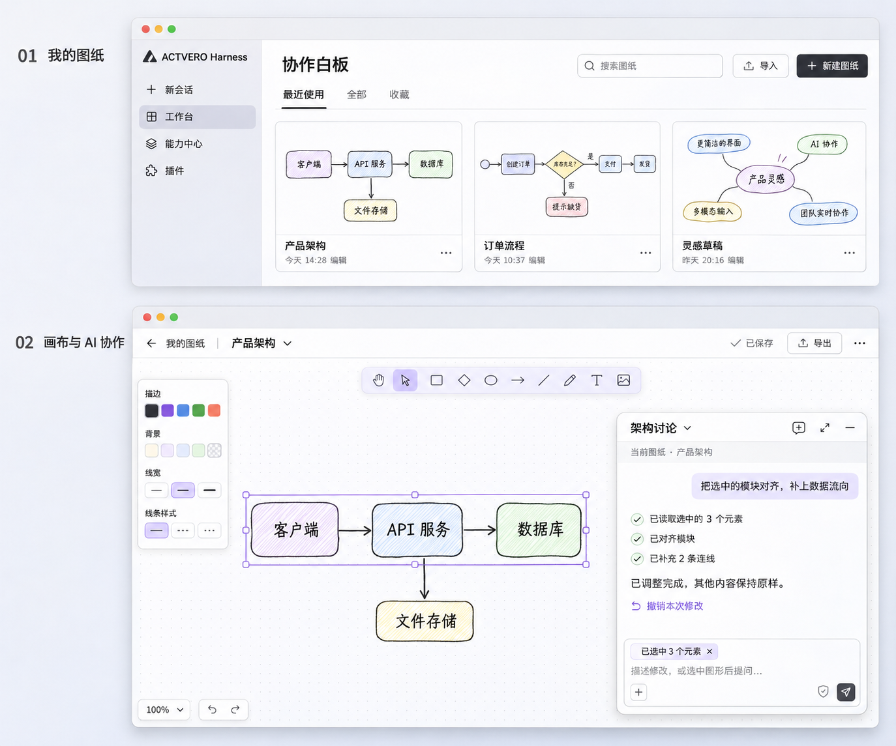

# Collaborative whiteboard requirements

English | [中文](requirements.zh.md)

## Readers and outcome

This document defines the first local release of “协作白板” for a developer Agent, developer or acceptance reviewer taking over the workbench. It specifies expected behavior and observable results, not delivered functionality. The user has confirmed the two-level structure and native canvas direction; use the name “协作白板” without collecting the same requirements again. Developers choose implementation details using the current workbench development guidance.

Users manage multiple drawings in ACTVERO, reopen one to continue drawing and collaborate through native AI chat when needed. Human and Agent edits affect the same drawing and survive closing and reopening. The core flow is “create drawing → draw manually → select some elements → ask AI to adjust them → inspect or undo changes → return to the list → reopen and continue”.

## Visual reference

The image establishes page hierarchy, information density and the floating chat relationship. Use the actual native Excalidraw editor with its drawing tools, property panel, selection, zoom and shortcuts; do not rebuild a canvas from the image. The management UI, menus and feedback use ACTVERO components and themes. Example drawings in the image illustrate the design; first use does not install pretend user drawings.

## Level one: My drawings

The manager offers search, import and New drawing, with recently used, all and favorites views. An empty list explains how to create or import. Cards emphasize drawing previews and show a single-line name, last modification time and overflow actions; card sizes do not depend on name or description length.

Opening a card restores its drawing and saved viewport. A new drawing is immediately editable without first creating a conversation or choosing a working folder. Names may initially be “未命名图纸” and changed later; renaming retains drawing identity and associated conversations.

Overflow actions include rename, duplicate, favorite or unfavorite, export and move to trash. Duplication creates an independent drawing. Trash supports restoration; the first release has no empty-trash or permanent deletion action. Recently used sorts by opening time, while modification time reflects content changes. Filters retain all drawings.

Importing a valid `.excalidraw` file creates a new drawing, retaining elements and embedded images without replacing same-named drawings. Invalid files report the cause and retain the existing list. Export both a re-importable `.excalidraw` file and a PNG of the current drawing.

## Level two: Native canvas

The top area offers a return to My drawings, editable drawing name, save status, export and overflow actions. Users can expand or collapse the application sidebar through native controls; public navigation and window controls remain available. The canvas occupies the main workspace. AI uses the native floating conversation without a separate chat engine, model picker or permission system.

Native tools create and edit shapes, text, arrows, connections and images, with undo, redo and zoom. Canvas theme follows the application. Returning to the manager and reopening restores content, embedded images, viewport and zoom. Previews update from saved content.

The AI float expands and collapses, using available native movement, position memory, new-conversation and full-conversation features. First use may show a lightweight AI entry; returning respects saved presentation choices. Opening a drawing does not send a model message.

## AI collaboration

Each drawing has a stable independent identity. Conversations explicitly associate with one drawing; returning can resume its previous conversation or start another discussion. Ordinary new conversations do not associate automatically, and conversations for different drawings must not read or modify each other's business content. Switching drawings does not retarget an executing task.

Users can select elements and ask AI to adjust them. Sending a request captures the referenced elements and drawing; later selection changes do not retarget the sent request. Show the selection reference where native UI permits and allow removing it. Report a missing native interaction explicitly rather than pretending it is connected.

The Agent must support the following operations. Developers choose business tools, MCP or CLI; the bundled expert supplies operation instructions and drawing rules. Multiple entry mechanisms are not required.

| Capability | Expected behavior |
|---|---|
| Read current drawing | Return explicit drawing identity, content version, elements, text and connections, not just an image |
| Read selection | Return this request's referenced elements and necessary adjacent relationships, including the no-selection case |
| Precise edits | Create, modify, move and delete elements by identity and connect existing nodes, preserving unrelated elements and images |
| Batch layout | Align and distribute selected elements as one understandable change |
| Inspect results | Obtain the updated scene and preview to inspect text, connections and layout |
| Undo changes | Undo one AI change as a whole without undoing subsequent human edits; reject unsafe undo with a reason |

Human and Agent edits use one authoritative data set. Each mutation includes its base version; stale AI changes must not silently overwrite edits made while AI was thinking. Require another read or report a conflict. A failed batch must leave no partial mutation. Deleting or trashing a drawing and clearing an entire canvas require explicit confirmation; ordinary reversible editing does not require a dialog per operation.

When AI is enabled, the bundled expert loads with the associated conversation and uses its model. It reads the drawing and relevant selection first, limits changes to the request, inspects results and reports briefly. It claims completion only after successful tools. Users do not configure another model for the expert. Without a model or when dependencies fail, manual editing, saving, import and export remain available.

## Data and reliability

Business data lives in the stable local directory assigned to the workbench by the host; authors choose the storage format. A workbench contains multiple drawings as business entities. Browser transient state or a conversation's current directory must not be the sole persistence mechanism. Drawing content, images, manager metadata and conversation associations have explicit ownership.

Edits save automatically, distinguishing saving, saved and failed states. A failed write retains the current view and unsaved content and allows retry. A failed read must not create a blank drawing over existing data. Reload, reopen and same-package upgrades retain data; unknown formats or damaged data produce recoverable errors rather than silent loss.

Drawing files are not automatically uploaded to a platform or external service, and real account credentials are not accessed. Import, export and AI access follow user actions and native authorization. Distribution includes needed business resources and third-party licenses. Handle or report external fonts and other resources affecting offline use.

## First-release scope

Deliver the local workflow, native AI integration, bundled expert and one genuinely callable canvas-operation mechanism. Platform publication, real-time multi-user collaboration, cloud sync, complex folder trees, online template markets and image generation are outside this release. Allow extension without adding placeholder pages or settings without business use.

## Acceptance cases

| ID | Action | Passing evidence |
|---|---|---|
| A1 | On first use, create two drawings and draw different content | Both appear independently and reopen correctly without AI or folder selection |
| A2 | Rename, search, favorite, duplicate and restore drawings | Filtering and ordering work; copies are independent, restoration retains content and identity relationships |
| A3 | Reopen and reload the client, then continue drawing | Elements, images, names, previews, viewport and zoom return without cross-drawing data |
| A4 | Import text and images, export and re-import, then import a damaged file | Valid content survives; invalid import preserves existing content; PNG is viewable |
| A5 | Select three nodes and ask the Agent to align them and add two connections | Tools read the correct drawing and selection; the canvas updates while unrelated content remains intact |
| A6 | Undo an AI batch, then attempt undo conflicting with later manual edits | Safe undo restores the intended changes; conflicts do not overwrite manual content |
| A7 | After the Agent reads A, manually edit A or switch to B, then submit stale edits | Version conflicts preserve A, B is unaffected and failed batches leave no partial writes |
| A8 | Create and resume conversations for one drawing, switch drawings, then open ordinary chat | Associations restore correctly without tool or context leakage into other drawings or ordinary conversations |
| A9 | Simulate storage read or write failure, then restore access | Failures are explicit, content remains, retry works and damaged data is not replaced by blanks |
| A10 | Edit long Chinese and English content in narrow windows, both themes, expanded/collapsed sidebar and AI float | Public entries work without clipped controls, vertical single-character text or whole-page horizontal overflow; essential actions support keyboard |
| A11 | Build and import this release's archive | Record exact package name, version, installation outcome, installed entry, switcher and actual business view evidence |

Record pass, fail, pending or not applicable with evidence for each case. Without a real model, actual business tools and controlled Agent requests may verify the call chain, but real-model collaboration remains pending. Test doubles do not replace actual Excalidraw or authoritative storage. Record package validation, installation and business acceptance separately.

## Development deliverables

Follow the [workbench development guide](../../workbench-development.md) and both project-generated Skills, maintaining project DESIGN.md and README.md. Deliver complete editable sources, a validated local package, execution and test instructions, third-party licenses and evidenced acceptance records. If a host capability is missing, identify the exact blocked step and usable scope. Do not bypass compatibility, claim unperformed installation or conceal framework gaps by changing the host or everyday user configuration.

## Official references

- [Excalidraw open-source editor](https://github.com/excalidraw/excalidraw)
- [Component integration](https://plus.excalidraw.com/docs/sdk/excalidraw/integration)
- [Canvas read/write API](https://plus.excalidraw.com/docs/sdk/excalidraw/api/props/excalidraw-api)
