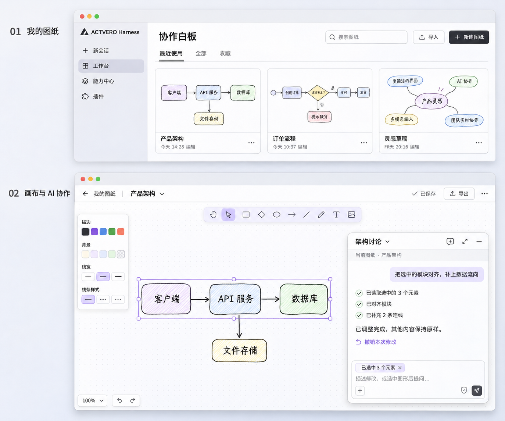

# 协作白板需求手册

[English](requirements.md) | 中文

## 阅读对象与目标

本文供首次接手「协作白板」的开发 Agent、开发人员与验收人员使用，规定第一版本地工作台的业务范围和可观察结果，不表示这些功能已经交付。用户已确认两层结构与原生画布方向，名称使用「协作白板」，无需重新收集同一批需求。具体技术选型由开发者依据当前工作台开发规范确定。

用户在 ACTVERO 中管理多张图纸，打开一张图继续绘制，需要时与原生 AI 对话协作；人工与 Agent 修改同一份图纸，关闭、重开后可以继续工作。核心流程为「新建图纸 → 手动绘制 → 选择部分图形 → 请 AI 调整 → 查看或撤销修改 → 返回列表 → 重开继续画」。

## 界面依据

效果图表达页面层级、信息密度及 AI 浮窗关系。画布采用真实的 Excalidraw 原生编辑器，保留原生绘图工具、属性面板、选择、缩放和快捷键；不依据图片重写一套画布。外层管理、菜单及反馈沿用 ACTVERO 组件与主题。效果图中的示例图纸仅是展示内容，首次使用不预装虚假用户图纸。

## 第一层：我的图纸

管理页提供搜索、导入和「新建图纸」，可查看最近使用、全部和收藏。空列表说明如何新建或导入。卡片以图纸缩略图为主，显示单行名称、最后修改时间与更多操作；卡片大小不随名称和简介长度改变。

点击卡片进入对应图纸并恢复已保存内容和视角。新建图纸立即可以手绘，不要求先创建对话或选择工作文件夹。名称可以暂用「未命名图纸」并随后修改；重命名不改变图纸身份和已关联对话。

更多菜单提供重命名、复制、收藏或取消收藏、导出和移入回收站。复制生成独立图纸，后续修改不影响原图。回收站可以恢复图纸；第一版不提供清空回收站或永久删除。最近使用按打开时间排序，修改时间反映内容变化；切换筛选不会丢失图纸。

导入有效的 `.excalidraw` 文件后生成新图纸，保留元素与内嵌图片，不覆盖同名图纸。错误文件说明原因并保留原列表。支持导出可再次导入的 `.excalidraw` 文件，以及当前图纸的 PNG 图片。

## 第二层：原生画布

顶部提供返回「我的图纸」、可修改的图纸名称、保存状态、导出及更多操作。用户可以通过宿主入口展开或收起侧栏，公共导航和窗口控件保持可用。画布使用工作区的主要空间，AI 使用宿主原生悬浮对话，不另建聊天引擎、模型选择器或权限系统。

用户可使用原生工具创建和修改图形、文字、箭头、连线与图片，并撤销、重做和缩放。画布主题跟随宿主。返回管理页和重开图纸时恢复内容、嵌入图片、视角与缩放；缩略图跟随已保存内容更新。

AI 浮窗可以收起、展开，沿用宿主提供的移动、位置记忆、新建对话与全屏对话能力。首次进入可以只显示轻量 AI 入口，恢复时尊重用户的显示选择。打开图纸不自动发送模型消息。

## AI 协作

每张图纸拥有独立且稳定的身份。对话明确关联一张图纸，重新进入时可继续该图的上次对话，也可新建讨论。普通新会话不自动关联；不同图纸的对话不可互相读取或修改业务内容。切换图纸不把执行中的任务改绑到新图。

选中图形后，用户可以让 AI 调整这部分内容。发送请求时捕获所引用的元素及其所属图纸，后续前端选区变化不改变已发送请求的目标。界面在宿主允许的位置显示选区引用，并允许取消引用；若当前宿主不支持对应交互，应明确报告差异，不伪装成已经绑定。

Agent 至少能够完成以下操作；具体通过业务工具、MCP 或 CLI 接入由开发者选择，专家包负责提供操作说明和绘图规则，不要求同时实现多套入口。

| 能力 | 期望行为 |
|---|---|
| 读取当前图纸 | 获取明确的图纸身份、内容版本、元素、文字与连线关系，不能只取得图片 |
| 读取选区 | 获取此次请求引用的元素与必要相邻关系，支持没有选区的情况 |
| 精确修改 | 按元素身份创建、修改、移动、删除元素并连接已有节点，保留未涉及的元素与图片 |
| 批量排版 | 能对选中元素完成对齐和间距调整，作为一次可理解的修改呈现 |
| 查看结果 | 可以获取修改后的场景与预览，判断文字、连接和布局是否符合要求 |
| 撤销修改 | 一次 AI 修改可以整体撤销，不连带撤销后续人工改动；无法安全撤销时明确拒绝并说明原因 |

手动编辑和 Agent 操作使用同一份权威数据。每次修改携带其基于的版本；用户在 AI 思考期间修改了图纸时，过期修改不得静默覆盖，应要求重新读取或说明冲突。批量操作中途失败不得留下半份修改。删除图纸、移入回收站或清空整张画布属于需明确确认的操作，普通可撤销编辑无需逐项弹窗。

工作台启用 AI 后，随包专家随关联对话加载，沿用该对话的模型。专家应先读取图纸与必要选区，尽量只修改用户要求的部分，再查看结果并简短汇报。只在工具确认成功后声称修改完成；不要求用户为专家单独配置模型。没有可用模型或依赖加载失败时，手绘、保存和导入导出仍可使用。

## 数据与可靠性

业务数据保存在宿主分配给工作台的稳定本地数据目录中，格式由作者选择。一个工作台中可有多张图纸，图纸划分属于工作台业务；不得依赖浏览器临时状态或某条对话的当前目录作为唯一持久化来源。图纸内容、图片、管理信息和对话关联需要有明确归属。

编辑自动保存，状态至少区分保存中、已保存和保存失败。写入失败保留当前画面与未保存内容并支持重试；读取失败不得创建空图覆盖原数据。刷新、工作台重开及同名包升级后保留数据；未知格式或损坏数据可恢复报错，不静默丢弃。

图纸文件不向平台或外部服务自动上传，不加载真实账号凭据。导入、导出和 AI 可访问范围由用户行为及宿主授权决定。分发包包含所需业务资源与第三方许可；外部字体或其他资源若影响离线使用，需明确处理或报告。

## 首版范围

第一版完成本地闭环、原生 AI 接入、随包专家以及一套真实可调用的画布操作入口。平台发布、团队多人实时协同、云同步、复杂目录树、在线模板市场和图像生成不在本版范围。可以保留扩展余地，不创建无业务用途的占位页面或设置项。

## 验收用例

| 编号 | 操作 | 通过依据 |
|---|---|---|
| A1 | 首次进入后新建两张图，分别绘制不同内容 | 两张图独立出现在列表中；再次打开内容正确，无需 AI 或文件夹选择 |
| A2 | 对图纸重命名、搜索、收藏、复制和恢复 | 筛选与排序正确；复制互不影响，恢复后内容及身份关系正确 |
| A3 | 关闭再打开、刷新客户端后继续画 | 元素、图片、名称、缩略图、视角和缩放恢复，无数据串图 |
| A4 | 导入含文字和图片的图纸，导出后再次导入；再导入坏文件 | 有效内容保留；错误导入不破坏已有内容；PNG 可查看 |
| A5 | 选择三个节点，让 Agent 对齐并补充两条连线 | 工具读取到正确图纸与选区；画布即时反映修改，其他内容不变 |
| A6 | AI 修改后整体撤销，再尝试撤销与后续人工编辑冲突的修改 | 安全撤销恢复目标变化；冲突时拒绝覆盖人工内容 |
| A7 | Agent 读取图 A 后人工修改 A 或切换到图 B，再提交旧修改 | 版本冲突不覆盖 A；图 B 不受影响；批量失败没有部分写入 |
| A8 | 新建与恢复同图对话，切到另一张图，再打开普通对话 | 关联恢复正确；业务工具和上下文不泄漏到其他图纸或普通会话 |
| A9 | 人为模拟存储读取或写入失败，然后恢复 | 失败明确、现有内容保留；重试成功，坏数据未被空白覆盖 |
| A10 | 在窄窗口、明暗主题、侧栏展开/收起及 AI 浮窗下编辑长中英文内容 | 公共入口可用，无控件裁切、单字竖排或整页横向溢出；必要操作可键盘访问 |
| A11 | 构建并导入本次安装包 | 记录精确包名、版本、安装结果、已安装条目、切换入口及真实业务界面证据 |

每项记录「通过／失败／待验证／不适用」与证据。没有真实模型时，可以通过实际业务工具和可控 Agent 请求验证调用链，但必须将真实模型协作单独记为待验证。测试替身不能代替真实 Excalidraw 画布或权威存储；包检查、安装与业务验收分别记录。

## 开发交付

按[工作台开发指南](../../workbench-development.zh.md)和项目生成的两份 Skill 开发，维护项目 DESIGN.md 与 README.md。提交可继续开发的完整源码、校验后的本地包、运行与测试说明、第三方许可，以及带证据的验收记录。需要宿主新增能力才能完成时，说明具体受阻步骤和当前可用程度；不绕过兼容检查、不冒充已安装，也不以修改宿主或日常用户配置来掩盖框架缺口。

## 官方参考

- [Excalidraw 开源编辑器](https://github.com/excalidraw/excalidraw)
- [组件集成](https://plus.excalidraw.com/docs/sdk/excalidraw/integration)
- [画布读写接口](https://plus.excalidraw.com/docs/sdk/excalidraw/api/props/excalidraw-api)
