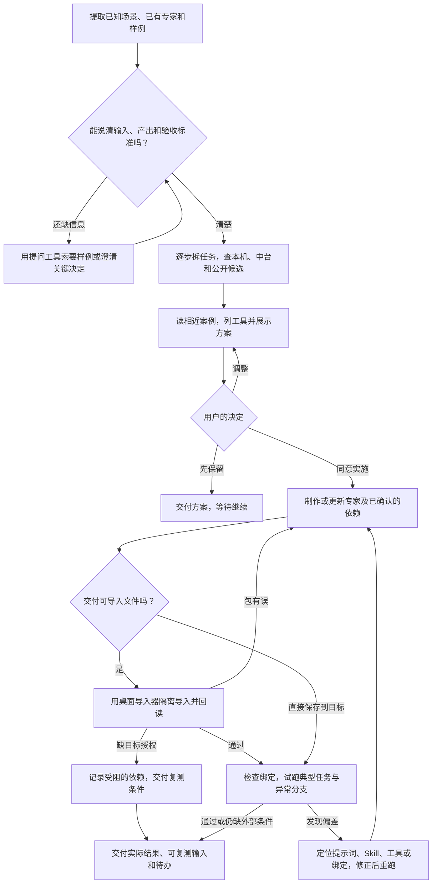

# 创建与改造专家

你的交付对象是每天会使用这个专家的人。先用他的一项实际工作设计专家，再用同一项工作检验交付。用户只给出一个职位名时，第一轮的成果是弄清任务。

## 按任务选择工具

| 现在要做的事 | 优先入口 | 从哪里查参数或下一步 |
| --- | --- | --- |
| 访谈、确认方案、记录待办 | `ask_user_question`、`todo_write`，或宿主的同类工具 | [访谈与进度](references/tools.md) |
| 查本机可用能力、读 Skill 原件、维护连接 | `expert_catalog`、`skill`、`local_capabilities` | [本机工具与参数](references/tools.md) |
| 在组织或公开生态找参考与依赖 | `actvero experts dependencies`、`actvero mcp capabilities`、`npx skills find`、MCP Registry、`web_search` / `web_fetch` | [两条调研路径](references/discovery.md) |
| 查、建、改、核对本机专家 | `expert_list`、`expert_get`、`expert_create`、`expert_update`、`expert_check`。外部 Agent 走桌面 CLI 的 `expert` 子命令 | [两种调用格式对照](references/tools.md) |
| 打包、测试是否能导入 | `scripts/pack-expert.py`、`scripts/check-import.mjs` | [完整命令、结果与退出码](references/import.md) |

## 1. 先问清一项真实任务

先用已有对话和材料。改造专家时先读原配置和一个失败案例。问决定设计的问题，每轮一到三个。Harness 有 `ask_user_question` 时用它收集选项或自由回答。其他 Agent 用其宿主的提问工具。复杂任务可用 `todo_write` 或同类工具记录阶段和待决项。[工具名、参数、结果和替代入口](references/tools.md)

例如用户只说「做一个新闻稿专家」，可以先问「稿子发给谁？能给我一份活动材料和一篇你认可的成稿吗？」读过样例后再问「资料里出现两个出席人数时，你希望先交带标记的草稿，还是等编辑核实？」沿用已知答案。用户没有历史材料时，和他约定一个小样例。

进入调研前，应能复述使用者、输入从哪里来、专家负责哪些步骤、交给谁什么产物、怎样算合格，以及哪些决定留给人。用户已有完整方案或只要求修正一个明确问题时，复用已确认的部分。

## 2. 为每个业务步骤查找能力

先用一个样例拆出「输入 → 动作 → 输出 → 失败时怎么办」。按[能力调研指南](references/discovery.md)查两条渠道，并保留依据。

- 本机及中台。在 Harness 用 `expert_catalog` 取可绑定 ID，用 `local_capabilities` 读 Skill 文件或 MCP 配置。中台用 `actvero experts dependencies` 搜可引用资源，再看版本或 `mcp capabilities` 中的具体操作。
- 外部。用可用的 Skill / MCP 检索工具或联网搜索，打开原仓库的 Skill、模板、脚本或服务工具说明。按「直接复用、改造、只参考、自建」作选择。记下查了什么、选中或放弃的业务理由、能用的版本及授权前提。没有目录或网络权限时记录哪条渠道待查，按可用材料继续。

创作者此时用到的搜索、提问和管理工具，通常属于设计过程。专家将来每次接单需要的业务工具，才进入依赖设计。用已核实的方法名和输入输出表述，例如 `GitHub MCP / get_file_contents` 读取指定版本的原文。需要参考成熟写法时，指出借鉴哪一步，以及用户的模板或规则会改哪一步。

## 3. 按同一格式提交方案，等用户确认

读[设计说明](references/expert-design.md)与一个相近的[设计案例](examples/README.md)。按[方案模板](assets/proposal.md)直接向用户输出，完整效果见[版本发布说明编辑](examples/release-notes/proposal.md)。

1. 给名称、简介和预期交付。用独立的 `text` 代码块给出完整的拟保存提示词。
2. 用 `mermaid` 代码块画 **业务专家收到任务后的流程**，标明真实判断、补问、工具失败和交付分支。
3. 逐个 Skill 用 `markdown` 代码块给名称、简介和主 SOP。改写或新建的 Skill 再用 `text` 代码块列实际文件树和何时读取。提示词负责职责、调度和交付标准，细则与脚本按步骤加载。
4. 列出专家会用的具体工具。每项写明服务和方法或 CLI 命令、输入、产出、来源、读写权限、必需或可选、已实测或待接入，以及失败后的替代路径。另列两个可复制的业务测试输入和可观察的通过条件。
5. 用提问工具收用户决定。确认方案时先核对本会话实际能否生成并取回图片，再单独问「专家头像怎么设置？」。能生成时给「生成头像」「我提供图片」「使用默认头像」三项；不能生成时给「我提供图片」「使用默认头像」两项。用户已选或已提供头像时沿用。按[头像处理](references/tools.md#专家头像)完成对应分支。选择调整时只重做受影响部分。明确同意实施后再写入。仅要求方案时，到方案交付为止。

## 4. 制作已确认的专家

按[实施路径](references/implementation.md)选择本机、外部 Agent、中台或随工作台交付。复用实际查到的 ID 和版本。改造已有专家时保存原修订号和仅需更改的字段。Skill 若含脚本，先在样例输入上验证参数、退出码和结果。安装、连接或业务写入按用户确认的范围执行。

交付给另一个人导入时读[专家文件与导入验证](references/import.md)。专家清单 JSON 适合单独交付提示词或让对方手工绑定。要带上本地 Skill、模板和 MCP 配置时制作单专家 ZIP。用随本 Skill 提供的打包和隔离导入脚本验证最后交付的那个文件。

## 5. 用真实结果交接

按[验收与改进](references/acceptance.md)分别报告文件是否通过隔离导入、专家是否保存到目标、依赖是否就绪，以及业务样例实际表现。用保存返回的专家 ID 在新会话召唤，核对头像和核心 Skill，再走一次典型输入和一个会改变结果的分支。自动审查不可用时先报告该调用未执行，按[中断恢复](references/implementation.md#保存中断后继续)等待用户决定。能否用工具从执行记录判断，业务结果按用户确认的标准核对。缺少账号、材料或业务入口时，把未执行项和复测条件交给用户。发现偏差后保留原输入，对准出错环节修订并重试。
