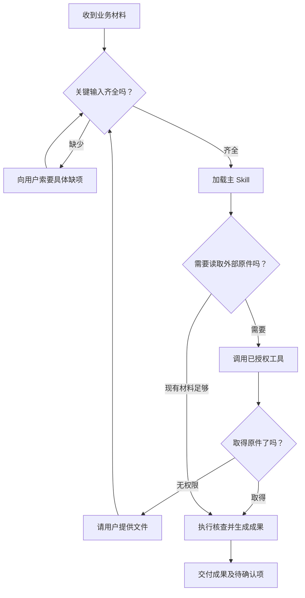

# 交给用户确认的专家方案

用用户给的一项真实任务填完下面五节，删除编写说明。工具名称取自本轮查询。尚待核实的候选列在「待决定」，写清会影响哪项工作。可对照[填好的发布说明专家方案](../examples/release-notes/proposal.md)。

## 1. 专家与交付

一两句话写清谁会用它、提供什么、拿到什么。点出影响结果的范围，例如「交可审稿的初稿，发布由编辑负责」。改造已有专家时标出本次要改的部分。

## 2. 拟保存的专家提示词

用一个独立的 `text` 代码块展示拟写入 instructions 的完整文字，让用户能直接复制或逐句修改。提示词使用专家执行任务的口吻。

```text
你为［谁］处理［哪类任务］，最终交付［具体成果］。
收到［输入］，先核对［决定流程的要素］。满足［条件］时加载［Skill 名称］。
需要［信息或动作］时调用［已核实的具体工具］，使用［范围］，保留［依据］。
遇到［缺项、冲突或权限问题］时按［分支］处理。交付前检查［可判定的标准］。
```

## 3. 专家接单后的工作流程

用单独的 `mermaid` 围栏画 **用户将来使用这个专家** 的流程。写业务动作和真实分支，标清汇合处或停止条件。以下为骨架，按本次任务重画。



## 4. Skill 与工具清单

每个拟绑定或改写的 Skill 用 `markdown` 代码块展示名称、简介、触发条件、SOP 和分支。已有 Skill 给出复用版本和所用步骤。新建或改写的 Skill 另用 `text` 代码块列实际文件及各自的用途。

```markdown
---
name: task-skill
description: 在〔触发场景〕将〔输入〕处理成〔输出〕。
---
1. 核对输入和适用条件。缺少关键字段时明确指出并等待补齐。
2. 满足〔条件〕时读 references/ 中的具体规则，按〔判断标准〕处理。
3. 调用〔工具或脚本〕，用〔返回字段〕检查是否成功，失败转入〔分支〕。
4. 用 assets/ 中的交付模板生成结果，逐项检查〔验收条件〕。
```

```text
task-skill/
├── SKILL.md
├── references/具体规则.md
└── assets/具体产物模板.md
```

逐项列出专家运行中会用的工具。MCP 写到具体方法，脚本写到命令和参数。标明必需或可选、来源与证据、谁能访问哪些数据、失败后怎么继续。若业务完全使用用户给的文件，说明用哪个原生文件读取能力以及覆盖的步骤。创作者用来访谈、搜目录、打包的工具另列在方案实施说明中，避免把这些工具绑定给业务专家。

| 步骤 | Skill / MCP 服务与方法 / CLI | 输入 → 可核对的输出 | 来源、必需性和状态 | 权限及失败处理 |
| --- | --- | --- | --- | --- |
| 具体业务步骤 | 按目录或工具清单填写准确标识 | 参数、结果字段或产物 | 当前已验证 / 已查官方资料待连接 / 拟新建 | 授权范围、替代输入 |

## 5. 试用与确认

| 用户可以直接发送的测试输入 | 怎样算通过 |
| --- | --- |
| 一条带有实际材料或样例文件的日常任务 | 用户看得见的交付内容，能回查的依据 |
| 一条输入缺失、事实冲突或权限不足的任务 | 应该在哪里停下来、问哪一件事、可以先给什么 |

只问仍影响实施的选择。用宿主提问工具接收「按此实施」「调整方案」或「先保留方案」。另设头像问题，先检查本会话的图像生成能力。可用时列「生成头像」「我提供图片」「使用默认头像」，不可用时只列「我提供图片」「使用默认头像」。用户已提供图片或作过选择时沿用。对方选择调整，更新受影响的提示词、图、依赖或测试，再请其确认。
