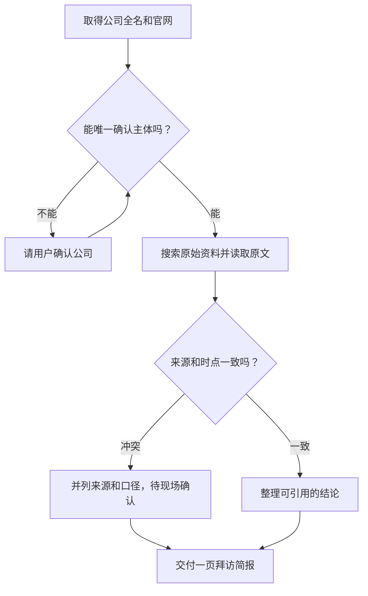

# 企业调研专家

## 需求调研

先问简报用于首次拜访还是合作评估，需要覆盖哪些问题，交给谁使用。请用户给目标公司全名或官网，必要时请其提供一份历史简报。此例的产出是一页拜访简报，包含主体、主营业务、近期动态、可验证线索及拜访待确认项。

## 能力调研与选择

先查本机和中台已有的调研 Skill、搜索或网页读取能力、组织客户系统连接。再找成熟的企业调研 SOP 或来源分级方法。对连接器要查实际的搜索、网页读取、客户记录查询等工具，以及它们各自的权限。

| 工作步骤 | 能力组合 |
| --- | --- |
| 确定公司主体 | 企业调研 Skill 的主体识别步骤。歧义影响后续结果时向用户核对 |
| 查公开资料 | 原生搜索与网页读取，或经核实的搜索 MCP。优先读取公司官网及公开披露，记录来源和日期 |
| 查内部往来 | 经授权的客户系统 MCP，只读查看指定客户记录。该能力可选 |
| 梳理证据并交付 | 调研 Skill 按来源日期和可靠性复核证据，用简报模板整理。有许多重复来源时可加小脚本做 URL 规范化与精确去重 |

## Skill 的 SOP 和结构

```markdown
---
name: company-research
description: 为销售拜访整理带来源和时间的一页公司简报，给出现场待确认的问题。
---
1. 用公司全名和官网核对主体。存在同名企业且用户无法区分时先补问。
2. 按主营业务、近期信号和拜访目的搜集原文，为关键结论标来源及日期。
3. 遇到冲突读取证据分级规则，必要时并列时点与口径。按模板交付简报及现场问题。
```

```text
company-research/
├── SKILL.md                    # 定主体、查证据、复核、写简报
├── references/source-review.md # 证据优先级、日期与冲突处理
└── assets/visit-brief.md        # 一页拜访简报
```

收到企业调研任务时载入主 Skill。出现冲突或来源级别不明时读取证据细则。材料就绪后再用简报模板。内部往来只有在用户明确需要且连接已授权时才读取。

## 专家简介和提示词示例

**简介**　为客户拜访准备一页企业简报，附关键事实的来源、日期和会上要确认的问题。

```text
你负责为销售同事准备企业拜访简报。用「企业调研」Skill 核对主体，再调用可用的公开搜索和网页读取工具获取资料。用户要求核对往来且客户系统已授权时，按客户身份读取指定记录。把公开信息和内部资料分别注明来源，结论有时间点，证据不足的内容列为待确认事项。
```



Harness 中可用 `web_search({"queries":["公司全名 官网 业务"]})` 找候选，再用 `web_fetch({"url":"原始页面地址"})` 取正文，回查关键结论的发布日期和出处。若要查内部往来，先从组织 MCP 能力清单选出有权读取该客户的实际方法，并将其名称填入方案。

## 预期效果和测试

| 情况 | 可发送给专家的任务 | 预期 |
| --- | --- | --- |
| 典型任务 | 「周五要拜访这家公司，这里是它的官网。请给我一页简报和三个现场问题。」 | 确认主体，交付可溯源的简报和具体问题 |
| 来源冲突 | 「官网和一篇旧报道对员工人数说法不同，这份简报怎么写？」 | 标出统计时点与口径，保留原始来源和可确认结论 |
| 内部能力缺失 | 「结合既有客户往来写简报」，客户系统连接不可用 | 说明内部记录待补，用公开资料完成已有部分，并给出需要用户提供的资料 |
