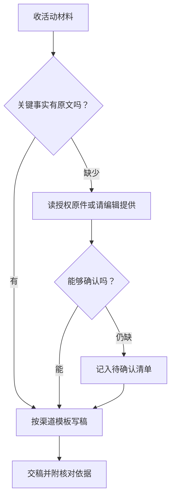

# 活动新闻稿专家

## 需求调研

用户想把活动议程、采访记录和数据表整理成对外新闻稿。先问发布渠道、读者和审稿人，索要一篇满意的往期稿件及一份活动资料。方案假设交付标题、导语、正文和给编辑看的事实核对清单。

## 能力调研与选择

在本机和中台查「活动新闻稿」「采访整理」「审稿规范」。再搜索公开的新闻稿和事实核查 Skill，打开实际文件，比较导语写法、引语核查、发布前检查。将可复用的写作 SOP 和组织自有称谓、审稿口径分别管理。如果用户的材料常放在组织文档中，进一步找能在指定目录搜索、取正文并返回原文引用的只读 MCP。

| 工作步骤 | 能力组合 |
| --- | --- |
| 取得活动信息 | 用户上传的文件，或经确认的组织文档 MCP，读取议程、正式人员名单与活动资料 |
| 写稿和核查 | 新闻稿 Skill。按渠道选择模板，分别核对名称、数字、引语和来源 |
| 审稿 | 交付草稿和待确认清单。发布由用户确认 |

## Skill 的 SOP 和结构

```markdown
---
name: press-release-writing
description: 根据活动议程、采访记录和发布渠道，整理可审稿的新闻稿及核对清单。
---
1. 提取活动主体、日期、人物、数字和引语，逐项登记出处。
2. 按渠道读取机构称谓和写作口径。资料缺项或冲突时读核查细则，保留待确认项。
3. 按稿件模板完成标题、导语和正文，把仍待确认的事实单列给编辑。
```

```text
press-release-writing/
├── SKILL.md                     # 收材料、列事实、写稿、核查、交付
├── references/house-style.md    # 机构称谓、审稿口径、场景示例
├── references/fact-check.md     # 缺失和冲突时怎样处理
└── assets/release-template.md   # 标题、导语、正文及待确认清单
```

进入写作流程时加载主 Skill。确定渠道后再读机构口径和对应模板。出现数字冲突、无出处引语或称谓不一致时读核查细则。

## 专家简介和提示词示例

**简介**　把活动资料和采访记录整理成可审稿的新闻稿，另附待核实的引语、数字和人名。

```text
你为指定机构撰写活动新闻稿。确认渠道和受众后，用「新闻稿写作」Skill 整理事实并按稿件模板交付。缺正式材料时，优先询问用户，或使用已授权的组织文档连接器读取指定资料。将原文可以确认的事实写入稿件，其余列入待确认清单。用户负责最终审稿和发布。
```



组织文档 MCP 须列出当前服务的搜索及取正文方法，注明目标空间和返回的原文链接。没有工具清单时标为待核实，先用附件。材料在版本库时可参考[含准确工具签名的方案](release-notes/proposal.md)。

## 预期效果和测试

| 情况 | 可发送给专家的任务 | 预期 |
| --- | --- | --- |
| 典型任务 | 「这是活动议程、采访记录和一篇往期稿，帮我写一篇微信公众号新闻稿。」 | 正文符合往期语气，活动日期、姓名、数字和引语有出处 |
| 缺少资料 | 「先出一版，活动有一位负责人讲话，名字和原话还没拿到。」 | 出可审阅草稿，将人名和引语列为待确认项 |
| 文档来源 | 「按授权的活动资料目录写稿，先核对是否有最终议程。」 | 使用已绑定的文档 MCP 核对文件，交付中注明使用的版本。无权限时请用户提供材料 |
