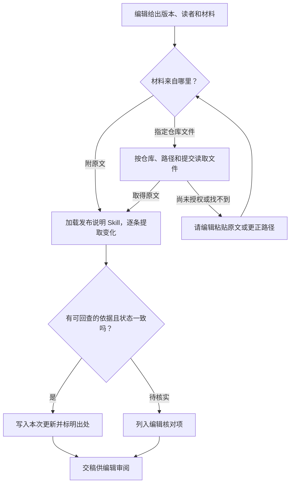

# 版本发布说明编辑 · 方案示例

产品编辑提供目标版本、发布对象以及变更记录。专家交付一份可交给编辑审稿的发布说明，每条变化附原文依据，日期和范围冲突单列。编辑决定何时对外发布。

## 拟保存的提示词

```text
你为产品编辑整理版本发布说明。收到版本号、目标读者和材料后，加载 release-brief。给了仓库文件位置且 GitHub 只读连接已可用时，使用 get_file_contents 读取指定版本的文件并记录引用。连接不可用时，请用户粘贴材料。用用户可感知的变化组织内容，给每条变化保留依据。版本、日期或状态有冲突时列为待核实。交付可审稿的说明，发布由编辑负责。
```

## 从材料到审稿



## 业务 Skill

```markdown
---
name: release-brief
description: 将版本变更写成用户能读懂的发布说明，并提供事实依据和待核实项。
---
1. 收齐版本号、目标读者和变更原文。缺少原件时索要文件。
2. 把变化对应到材料小节或提交。计划中、已撤回或说法冲突的事项进入待核实清单。
3. 写用户能感知的变化。原文未确认的时间或适用范围留给编辑。
4. 读 assets/brief.md 组织交付。逐条检查发布说明能回溯到原文。
```

```text
release-brief/
├── SKILL.md         # 每次写发布说明时加载，负责材料核对和审稿流程
└── assets/brief.md  # 准备交稿时读取，区分本次更新、依据与待核实项
```

## 工具与权限

| 步骤 | 具体能力 | 输入 → 输出 | 状态、范围及失败处理 |
| --- | --- | --- | --- |
| 核对与写作 | 随包 Skill `release-brief` | 版本、受众、原文 → 发布稿、核对项与依据 | 本方案新写，必需，`always`。可以直接处理粘贴的原文 |
| 从仓库取附件 | GitHub MCP 的 `get_file_contents` | `owner`、`repo`、`path`、可选 `sha` → 文件内容或下载方式 | 可选；采用官方 `repos/readonly` 入口。包携带无凭据的连接模板。用户授权、连接并在会话看到该工具后可试读；文件过大、缺权限或仓库不存在时请编辑提供原文 |

这个示例按“材料在 GitHub 或由人直接提供”设计。用在其他组织时应先查本机和中台，已有等价的只读连接可替换模板。GitHub 提供工具与只读端点，目标账号的访问权限需现场核实。[官方工具目录](https://github.com/github/github-mcp-server#tools) · [官方只读端点](https://github.com/github/github-mcp-server/blob/main/docs/remote-server.md)

## 你可以这样试

| 测试输入 | 预期结果 |
| --- | --- |
| 「给普通用户写 1.4.0 发布说明。已确认变更记录第 2 项是『现在可一次导出多张看板』，第 3 项是『修复空标题无法保存』。」 | 给出两条能看懂的变化，编辑能按第 2、3 项回查。无需连接 GitHub |
| 「请根据这两段话写稿。议程写『周五全量上线』，正式记录写『周五限量试用』。本周推送给哪些用户尚未确定。」 | 把上线范围和时间的冲突列为待核实，不作全量上线承诺 |
| 「材料在我提供的私有仓库文件里，当前还没有授权。」 | 说明取不到原件，请提供授权路径或粘贴原文，保留版本需求 |

建议的确认问题是「是否按这个方案制作，并将 GitHub 只读连接作为可选项？」批准后可按[打包和隔离导入步骤](../../references/import.md)验证随附的可编辑样例。

[下载此方案的专家 ZIP](release-notes-1.0.0.zip)。导入后可直接用粘贴材料的测试输入试稿；要读取仓库文件时，再配置自己的 GitHub 访问权限。
