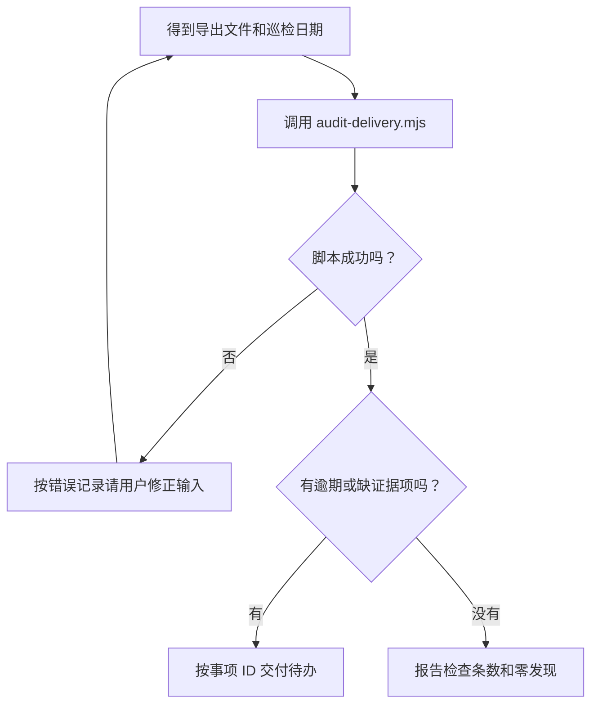

# 本地交付巡检工作台与随包专家

## 需求调研

项目负责人每天要巡视一批交付项。输入是工作台导出的交付明细 JSON，用户期望得到逾期项、已就绪但缺证据的事项，以及跟进优先级。先索要一份真实导出和人工巡检结果，确认日期口径、状态、哪类标记需要人工复核。此例只巡检，不替用户改变交付状态。

## 能力组合

| 阶段 | 能力 | 负责的动作 |
| --- | --- | --- |
| 制作页面与本地交付 | `develop-workbench`、`workbench-frontend`、Harness 内置工作台 CLI | 确认运行环境，构建页面与随包专家。目标客户端提供 `update` 时，经确认后使用它应用一次，再通过 `status` 和页面核对 |
| 专家巡检 | 「交付巡检」Skill | 识别正确的交付数据和巡检日期，选择规则，解释脚本发现，形成业务摘要 |
| 执行固定规则 | 随包 Node.js CLI 脚本 | 只读指定的数据文件，检查逾期及证据缺失，以 JSON 返回结果 |
| 呈现给用户 | 专家提示词和工作台页面 | 按交付项展示问题与原始标识，优先解释逾期项。维护者从页面或会话继续操作 |

调研时仍先查本机和中台是否有可复用的交付 Skill 或导出工具，再查成熟的巡检 SOP。当前流程只读本地数据，本地 CLI 已覆盖主要检查。未来需要读取组织工单时，可另提方案，查证合适的 MCP 和读取权限。

## 随包 Skill 的 SOP

```markdown
---
name: delivery-audit
description: 巡检本地交付 JSON，列出已逾期和缺证据的事项及跟进顺序。
---
1. 按用户所选交付对象获取导出路径。由用户指定日期，或沿用任务明确的时点。
2. 读字段和规则说明。运行随包 CLI 检查，不在聊天里猜测逾期项。
3. 把返回的事项按规则解释。对逾期项给出优先处理理由，将缺证据项变成具体待办。
4. 输入无效时用脚本诊断定位问题，向用户索要有效导出。用户要求变更数据时，确认实施范围并使用另行获准的写入能力。
```

```text
assets/
├── expert.json                             # 简介、提示词、Skill 和工具声明
├── dependencies.json                       # 绑定随包 Skill 和 Node.js CLI
├── scripts/audit-delivery.mjs                # 可执行的只读巡检
└── skills/delivery-audit/
    ├── SKILL.md                             # 选数据、检查、解释和交付
    └── references/fields-and-rules.md       # 字段、规则、日期口径和错误处理
```

随包绑定的具体字段和命令前缀以目标工具链的「随包专家、Skill、MCP 与 CLI」指南为准。专家只在巡检时读规则和运行脚本。安装与更新命令属于开发阶段。

## 专家简介和提示词示例

**简介**　巡检本地交付清单，列出逾期和缺证据的事项，并按优先级给出后续处理建议。

```text
你负责本地交付清单巡检。先确认交付对象、数据文件和巡检日期，使用「交付巡检」Skill 和绑定的 CLI 检查。用返回的事项 ID、日期和规则解释问题，优先列出逾期项。文件无效或日期不明确时先说明缺口，等待正确输入。交付摘要和建议由用户决定是否采取。
```



业务 CLI 的具体调用、返回结果和坏输入见下方可运行命令。工作台维护者用于部署的 `update` 与 `status` 只在交付新版时调用。

## 可运行的脚本示例

在创建专家 Skill 根目录运行：

```sh
node examples/workbench-delivery/scripts/audit-delivery.mjs \
  --input examples/workbench-delivery/fixtures/deliveries.json \
  --as-of 2026-11-20
```

输入记录包含 `id`、`status`、`dueDate` 和可选的 `evidence`。状态支持 `pending`、`ready`、`delivered`。未交付项在到期日早于巡检日期时标为逾期。状态为 `ready` 且缺证据时标为待补证据。该命令不会写入文件。有业务发现时仍返回退出码 0，无效输入返回退出码 1 和 JSON 诊断。

样例应返回三条已检查记录。A-01 逾期，A-02 缺证据，A-03 无发现。可查看[样例输入](fixtures/deliveries.json)与[脚本](scripts/audit-delivery.mjs)。

## 工作台和专家试跑

| 情况 | 可发送给专家的任务 | 预期 |
| --- | --- | --- |
| 典型任务 | 「按 2026-11-20 巡检这份交付表，给我应该先处理的两项。」 | 脚本返回 A-01、A-02。摘要保留原始 ID，逾期项排在前 |
| 无效日期 | 「巡检这份表」，表中一项到期日为 `2026-02-31` | 返回具体记录的日期诊断，请用户修正导出 |
| 工作台交付 | 「按已确认方案应用新版，并打开验证。」 | 核对 CLI 安装与加载结果。打开工作台观察新版界面，从原有记录再跑一条巡检 |
